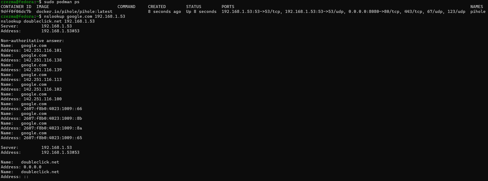
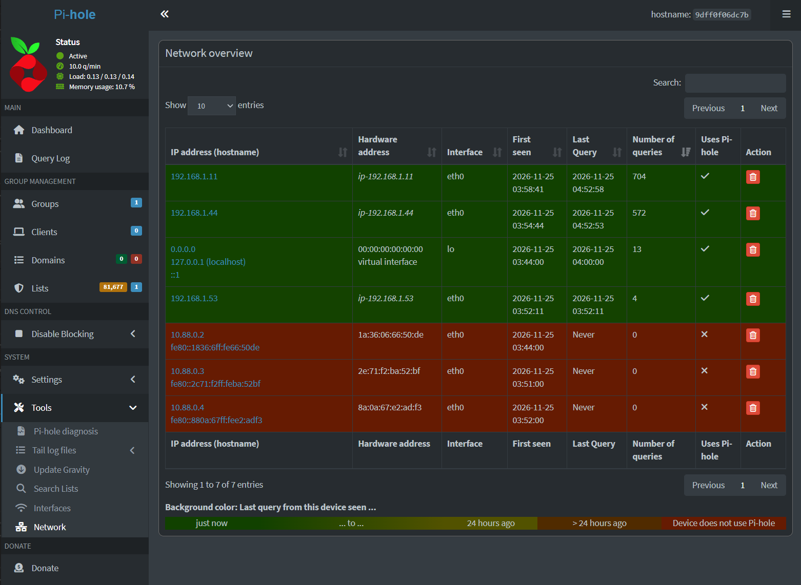

# Pi-hole Homelab Deployment

## Overview

I set up Pi-hole inside a Podman container on my Fedora Linux server to block ads and trackers for my own devices on my home network without changing the router's default DNS for everyone else in my home.

## Tools & Technologies

- **OS & Security:** Fedora Linux, `firewalld`, SELinux
- **Containerization:** Podman
- **Networking & DNS:** Pi-hole v6, DNS (TCP/UDP port 53), DHCP Address Reservation

## How It Works

1. **Static Local IP:** I reserved `192.168.1.53` for the Fedora server on my router so its local IP never changes after a reboot.
2. **Container Isolation:** Pi-hole runs inside a Podman container on its own internal virtual network (`10.88.0.0/16`), with only port `53` (DNS) and port `8080` (web dashboard) exposed to my LAN.
3. **DNS Filtering:** My personal devices send all DNS lookups to `192.168.1.53`. Pi-hole checks requests against its blocklists, returning `0.0.0.0` for blocked ad/tracking domains and forwarding normal requests to `1.1.1.1` and `9.9.9.9`.

## What I Did

- Checked the server's active Wi-Fi interface and reserved a static LAN IP on the router for it.
- Opened port `53` (TCP and UDP) in `firewalld` for DNS traffic while leaving other non-ephemeral ports closed by default, and mapped the admin page to port `8080`.
- Created a local directory for Pi-hole's config and blocklists and launched the container with `--restart unless-stopped` so it survives server reboots.
- Added the `:Z` flag to the volume mount so SELinux allows the container to write to that specific folder without giving it access to anything else on the host.
- Set `FTLCONF_dns_listeningMode="ALL"` so Pi-hole accepts queries routed across Podman's virtual bridge network from my home LAN.
- Configured my Windows PC and iPhone to use `192.168.1.53` as their only DNS server, leaving the alternate DNS blank and turning off DNS-over-HTTPS / iCloud Private Relay so queries don't bypass Pi-hole.

## Verification

### Container Status & `nslookup` Test

Verified that the container is listening on `192.168.1.53:53` and `8080`, resolving normal domains (`google.com`) while returning `0.0.0.0` for blocked ad domains (`doubleclick.net`):

### Active Clients in Pi-hole

Confirmed in Pi-hole's network overview that only my manually configured devices (`192.168.1.11` and `192.168.1.44`) are routing DNS queries through the container:

## What I Learned

- **Alternate DNS is NOT a strict backup:** Devices query both primary and secondary DNS servers at the same time, so leaving an alternate DNS filled in lets traffic leak around Pi-hole.
- **Container networking & SELinux:** Podman puts containers on a separate private subnet behind NAT and restricts file access with SELinux by default, meaning you have to explicitly allow cross-subnet DNS queries and label mounted folders (`:Z`).
- **Client-side DNS bypasses:** Features like browser DNS-over-HTTPS and Apple's Limit IP Address Tracking tunnel DNS over port 443 and have to be turned off on local networks for Pi-hole to catch everything and prevent queries from slipping through.

## Next Steps

- Pair Pi-hole with **Unbound** so the server resolves DNS queries recursively instead of relying on third-party upstream providers.
- Route my phone's DNS through the server remotely over **Tailscale** when I'm away from home.
- Set up automated backups for Pi-hole's blocklists and configuration files.